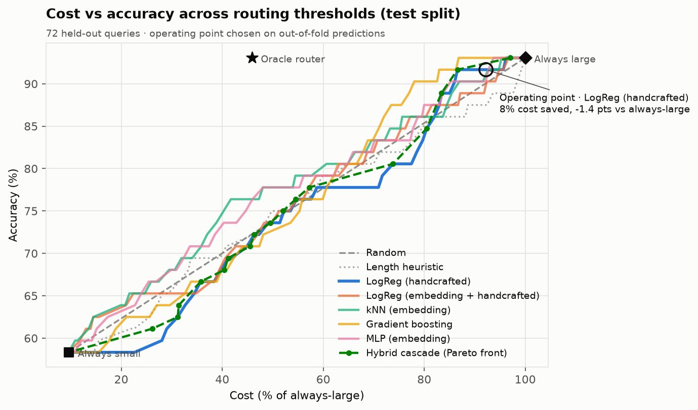

# Cost-Aware LLM Router

**Send easy questions to a cheap model and hard ones to an expensive model, without losing
quality.** A small classifier predicts, before any LLM is called, whether the cheap model will
answer correctly. Easy queries go to the small model, hard ones to the large model, and an
optional self-check escalates uncertain answers. Everything is evaluated on GSM8K (math) and
MMLU (multiple choice), where every answer is checkable, and everything runs on free services.

<!-- RESULTS:START -->
## Results so far (535 of 3,029 queries labelled; collection continues daily)

Small `allam-2-7b` vs large `openai/gpt-oss-120b`, both on Groq's free tier. Test split: 72
held-out questions, scored once. Full report: [reports/free_allam/RESULTS.md](reports/free_allam/RESULTS.md).

| | Accuracy | Cost (% of always-large) | Sent to large | Hard queries sent to small |
|---|---|---|---|---|
| Always large | 93.1% | 100% | 100% | 0% |
| Always small | 58.3% | 9.6% | 0% | 100% |
| **Router at the 2-point budget** | **91.7%** (−1.4 pts) | **92.2%** (7.8% saved) | 84.7% | 4.0% |
| Router at the 5-point budget | 91.7% (−1.4 pts) | 87.2% (12.8% saved) | 76.4% | 4.0% |
| Oracle (upper bound) | 93.1% | 45.9% (54.1% saved) | 34.7% | 0% |

- Every learned router beats random routing on the curve: **APGR 0.58–0.61 vs 0.48** for random
  (RouteLLM reports 0.60–0.62 for its best routers on MMLU / GSM8K).
- The saving at a ≤2-point loss is modest so far (95% CI 3.5–13.4%). The test set has 72
  questions, so every interval is wide; the numbers tighten as daily collection fills the
  remaining 2,494 questions.
- The self-check (2 extra samples, majority vote) catches only 30% of the small model's
  mistakes (precision 90%), so the tuned hybrid policy chose not to use a middle band.
- Routing adds one CPU embedding + a logistic regression: about 19 ms on an idle laptop
  (measured during development; the report records the load-affected measurement).


<!-- RESULTS:END -->

## How it works

```text
OFFLINE (once, replayed from cache)            ONLINE (per request)
 GSM8K + MMLU  ->  both LLMs answer          client --> gateway: embed + features --> p = P(small ok)
 grade vs gold  ->  label y = small correct              p >= tau_high  -> small model
 features: MiniLM embedding + 17 text stats              middle band    -> small + self-check -> large if it fails
 train 7 routers, sweep 101 thresholds                   p <  tau_low   -> large model
```

- **Models (free, Groq):** small `allam-2-7b`, large `openai/gpt-oss-120b`. Chosen by scoring
  all available pairs on a 200-question pilot (`python -m costrouter pairs`): this pair had a
  38.7-point accuracy gap, the only free pair with enough to route on.
- **Routers:** random, length heuristic, logistic regression (handcrafted / embedding),
  kNN, gradient boosting, MLP. All calibrated; the best by validation APGR is used.
- **Cascade:** parse check + self-consistency (2 extra small-model samples; pass if at least
  2 of 3 answers agree), in a three-zone hybrid policy.
- **Metrics:** accuracy vs always-large, % cost saved (list prices from real token counts),
  added latency, hard-query mis-route rate, plus RouteLLM's PGR / APGR / CPT, bootstrap 95%
  confidence intervals and McNemar's test.

## Quick start

```bash
python -m venv .venv
.venv\Scripts\activate                       # Windows; macOS/Linux: source .venv/bin/activate
pip install torch==2.14.1 --index-url https://download.pytorch.org/whl/cpu
pip install -e ".[dev]"

python -m costrouter data prepare            # GSM8K + MMLU -> 3,029 queries, stratified splits
python -m costrouter pilot --dry-run         # whole pipeline on fake models, no key needed

copy .env.example .env                       # add a free GROQ_API_KEY (console.groq.com/keys)
python -m costrouter pilot --profile free_allam          # 200-question go/no-go check
python -m costrouter pairs                   # score every candidate model pair on the pilot
python -m costrouter collect --self-consistency 2        # resumable; stops at the daily cap
python -m costrouter reproduce               # grade, train, sweep, evaluate, figures (no API)

python -m costrouter serve                   # OpenAI-compatible gateway on :8000
python -m streamlit run dashboard/app.py     # threshold explorer
```

`router <command>` is the same CLI through the installed launcher. On Windows with Smart App
Control on, unsigned launchers and some new compiled wheels are blocked, so use
`python -m costrouter`. That is also why compiled dependencies are pinned in `pyproject.toml`.

### Free-tier collection

Groq's free tier caps `gpt-oss-120b` at 1,000 requests and about 200K tokens per day, which
is about 500 queries a day. `collect` runs in a fixed, seeded random order, so a run cut short
by the cap still leaves a balanced sample of every split, and it stops calling a model as soon
as that model's daily cap is reached. Re-run `collect` once a day and then `reproduce`; every
number and figure is rebuilt from the cache.

### Using the gateway

```python
from openai import OpenAI

client = OpenAI(base_url="http://localhost:8000/v1", api_key="unused")
r = client.chat.completions.create(
    model="router-cascade",            # or router-quality, router-balanced, router-0.62
    messages=[{"role": "user", "content": "What is 15% of 80?"}],
)
print(r.choices[0].message.content, r.model)   # the response also carries x_router details
```

`POST /route` returns only the routing decision (no LLM call); `GET /metrics` reports requests
per model and cumulative cost vs the always-large estimate.

## Layout

```text
configs/            model profiles (prices, rate limits), dataset sizes
src/costrouter/
  data/             loaders, versioned prompts, answer checkers, splits, graded tables
  llm/              OpenAI-compatible + fake clients, rate limiter, SQLite cache, collector
  features/         handcrafted text features, cached sentence embeddings
  routers/          Router interface, baselines, scikit-learn routers
  cascade/          self-check signals, hybrid policy, Pareto front
  eval/             cost model, metrics, sweeps, stats, plots, experiment, report, pilot
  serve/            routing service + FastAPI app
  cli.py            `python -m costrouter ...`
dashboard/app.py    Streamlit threshold explorer
reports/            pilot reports, pairs.json, <profile>/RESULTS.md, results.json, figures/
tests/              offline tests (fake models, stubs)
IMPLEMENTATION.md   the original design document
PROJECT_LOG.md      every assumption and decision made while building
```

## Tests

```bash
pytest -q
ruff check . && ruff format --check .
```

All tests run offline on fake models and stubs; CI never calls a real API.
