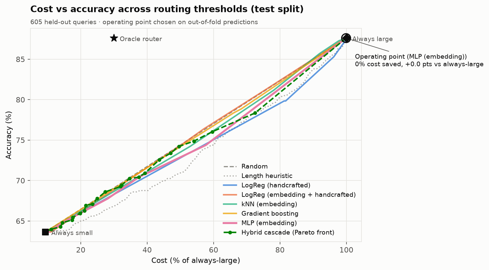
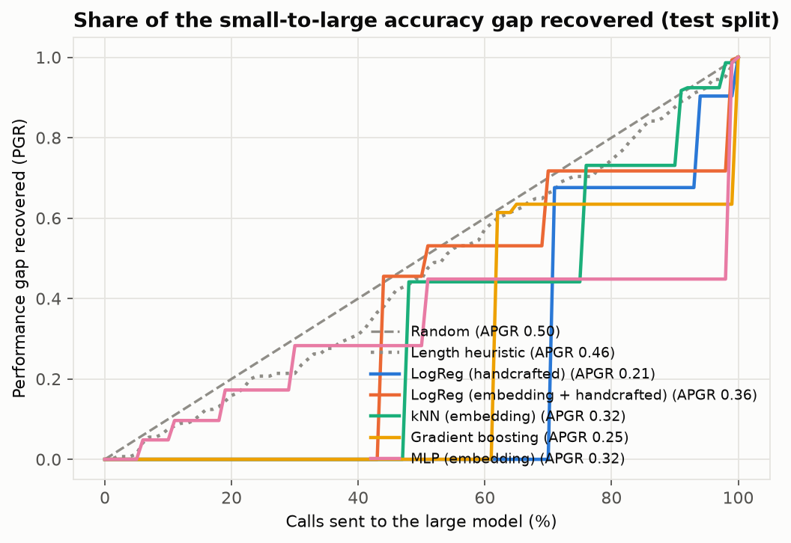
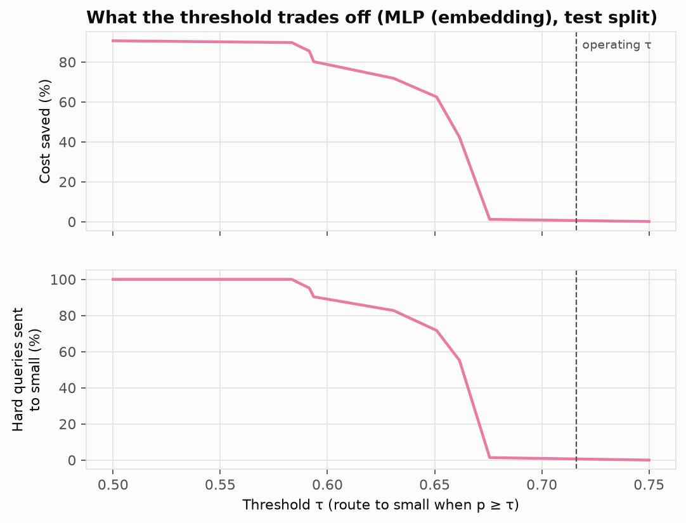
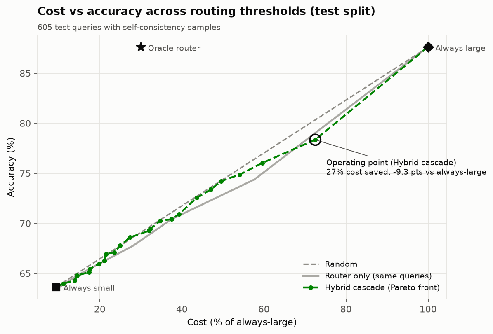
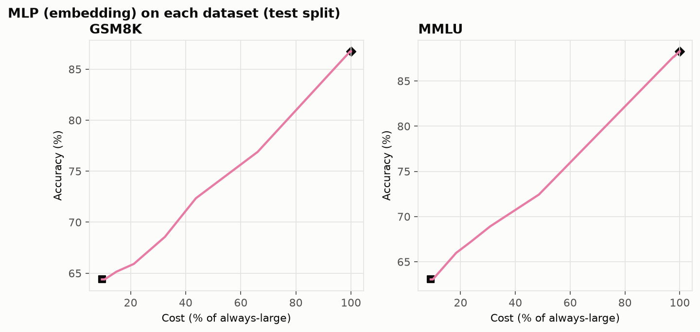
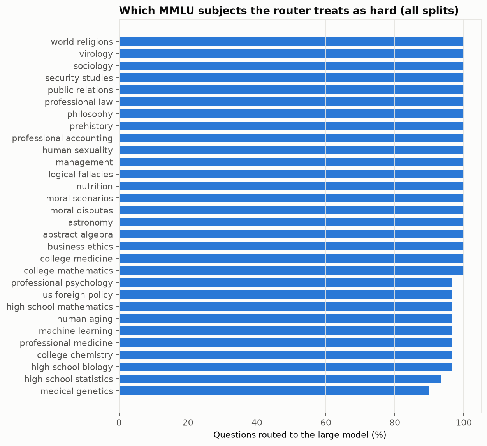
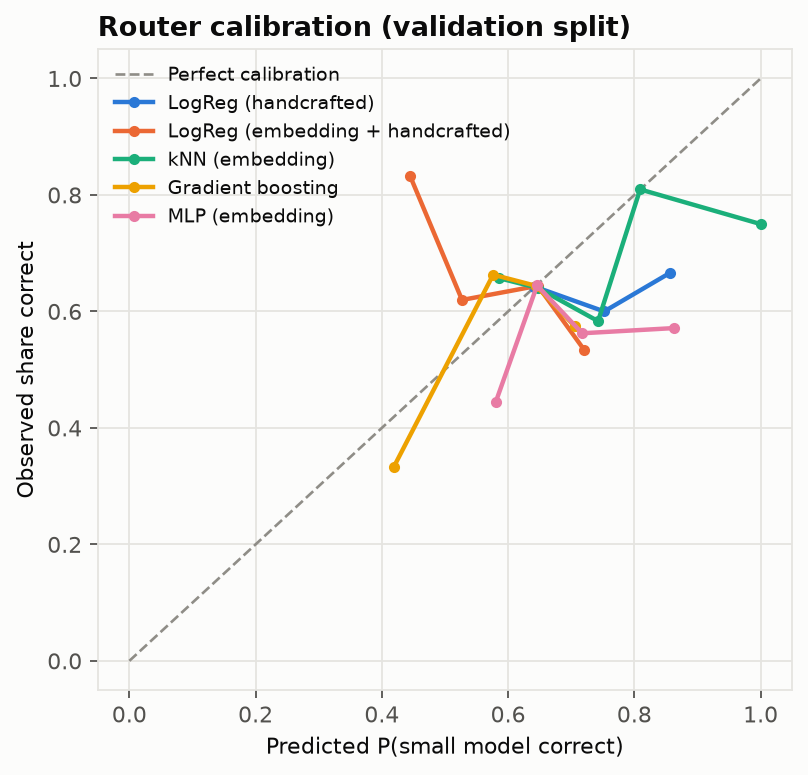
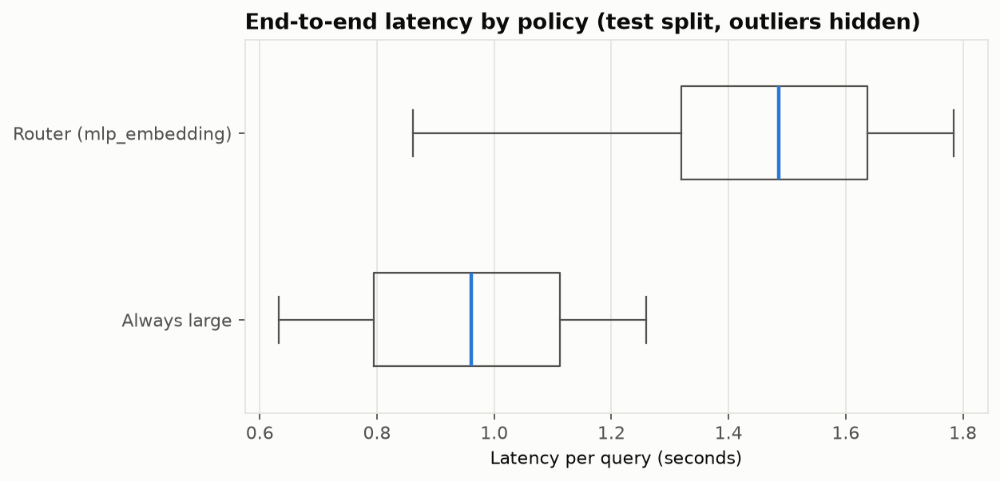

# Results

Generated 2026-10-24 from cached answers · profile `dryrun` · small `fake-small` vs large `fake-large` · prices as of 2026-10-24.

Labelled queries: 1815 train / 606 validation / 605 test (of 3029 in the full query set). Routers were compared and thresholds chosen on 5-fold out-of-fold predictions over train + validation; the final routers were refit on train + validation; the test split was scored once.

## Headline

**MLP (embedding) saved 0.1% of LLM cost (95% CI [0.0%, 0.3%]) with a +0.0-point accuracy change vs always using the large model (95% CI [0.0 pts, 0.0 pts]), adding 525 ms (p50) of routing latency.**

- Accuracy 87.6% vs 87.6% always-large and 63.6% always-small.
- 99.8% of queries went to the large model.
- Hard-query mis-route rate 0.0% (95% CI [0.0%, 0.0%]): share of queries only the large model solves that were sent to the small one.
- McNemar test vs always-large: p = 1.000 (0 queries only the router got right, 0 only always-large got right).
- Routing overhead (embedding + classifier, CPU): p50 525.0 ms, p95 1292.4 ms.
- Oracle router (upper bound): 70.0% saved at 87.6% accuracy.

## All routers (test split)

| Router | Accuracy at τ | Δ vs large | Cost saved | % to large | Hard mis-route | APGR (mean ± sd, 3 seeds) | CPT(50%) | CPT(80%) | CV ROC-AUC |
|---|---|---|---|---|---|---|---|---|---|
| Random | 84.8% | -2.8 | 6.7% | 92.2% | 11.7% | 0.498 | 52.0% | 85.0% | 0.504 |
| Length heuristic | 84.5% | -3.1 | 7.0% | 89.6% | 13.1% | 0.459 | 54.0% | 84.0% | 0.525 |
| LogReg (handcrafted) | 87.4% | -0.2 | 0.1% | 99.8% | 0.7% | 0.171 ± 0.057 | 71.0% | 94.0% | 0.483 |
| LogReg (embedding + handcrafted) | 87.4% | -0.2 | 0.8% | 98.8% | 0.7% | 0.305 ± 0.038 | 51.0% | 99.0% | 0.507 |
| kNN (embedding) | 87.1% | -0.5 | 2.6% | 97.0% | 2.1% | 0.331 ± 0.024 | 76.0% | 91.0% | 0.497 |
| Gradient boosting | 87.6% | +0.0 | 0.1% | 99.8% | 0.0% | 0.240 ± 0.095 | 62.0% | 100.0% | 0.483 |
| MLP (embedding) **(best)** | 87.6% | +0.0 | 0.1% | 99.8% | 0.0% | 0.250 ± 0.069 | 99.0% | 99.0% | 0.501 |
| Always small | 63.6% | -24.0 | 90.7% | 0% | 100% | 0 | | | |
| Always large | 87.6% | 0.0 | 0% | 100% | 0% | 1 | | | |
| Oracle | 87.6% | +0.0 | 70.0% | 24.0% | 0% | | | | |

APGR = area under the performance-gap-recovered curve (random = 0.5). CPT(x%) = share of calls to the large model needed to recover x% of the accuracy gap. The best router is the learned router with the highest out-of-fold APGR.

### The full trade-off (best router, test split)

Each row's threshold was chosen on out-of-fold predictions for that accuracy budget, then scored once on test.

| Allowed drop | τ | Accuracy | Δ vs large | Cost saved | % to large | Hard mis-route |
|---|---|---|---|---|---|---|
| 1 pts | 0.716 | 87.6% | +0.0 | 0.1% | 99.8% | 0.0% |
| 2 pts | 0.716 | 87.6% | +0.0 | 0.1% | 99.8% | 0.0% |
| 5 pts | 0.660 | 74.4% | -13.2 | 42.3% | 50.4% | 55.2% |
| 10 pts | 0.654 | 74.4% | -13.2 | 42.3% | 50.4% | 55.2% |

## Self-check cascade

Evaluated on the 605 test queries that have 2 extra small-model samples. Check = the main answer parses and at least 2 of 3 answers agree.

| Policy | Accuracy | Δ vs large | Cost saved | % answered by large | Hard mis-route | % checked | p95 latency |
|---|---|---|---|---|---|---|---|
| Router only | 87.6% | +0.0 | 0.1% | 99.8% | 0.0% | 0.0% | 1.8 s |
| Hybrid (τ_low 0.66, τ_high 0.88) | 78.3% | -9.3 | 27.5% | 55.7% | 38.6% | 49.6% | 1.9 s |
| Cascade only (always small first) | 72.6% | -15.0 | 56.4% | 13.2% | 62.8% | 100.0% | 2.3 s |
| Always large | 87.6% | +0.0 | 0.0% | 100.0% | 0.0% | 0.0% | 1.2 s |

Check quality: precision 96.2%, recall 35.0% for 'check failed' as a detector of 'small model was wrong'; it fails on 13.2% of queries.

## Robustness

- **GSM8K** (264 test queries): small 64.4%, large 86.7%; at τ accuracy 86.7%, 0.0% saved, 100.0% to large, APGR 0.336.
- **MMLU** (341 test queries): small 63.0%, large 88.3%; at τ accuracy 88.3%, 0.2% saved, 99.7% to large, APGR 0.304.
- **Generalisation GSM8K → MMLU**: trained on 791 GSM8K queries only, APGR 0.460 on 341 MMLU test queries (random = 0.5).
- **Generalisation MMLU → GSM8K**: trained on 1024 MMLU queries only, APGR 0.236 on 264 GSM8K test queries (random = 0.5).

## Where the router fails

Hard queries (only the large model was right) that the router most confidently sent to the small model:

| Query | p(small ok) | Text |
|---|---|---|

## API threshold presets (from out-of-fold predictions)

| Preset | τ |
|---|---|
| `router-quality` | 0.716 |
| `router-balanced` | 0.643 |
| `router-budget_30` | 0.640 |
| `router-budget_70` | 0.654 |
