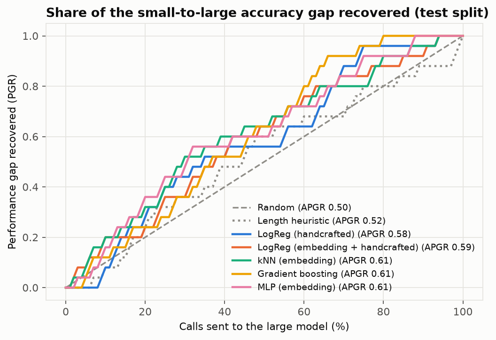
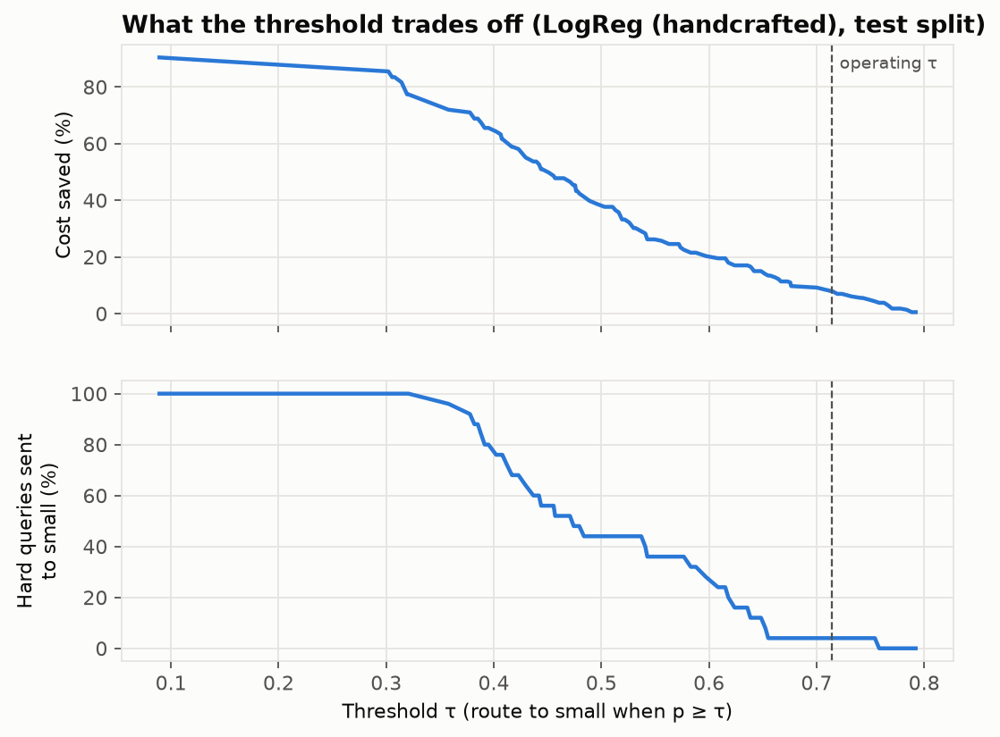
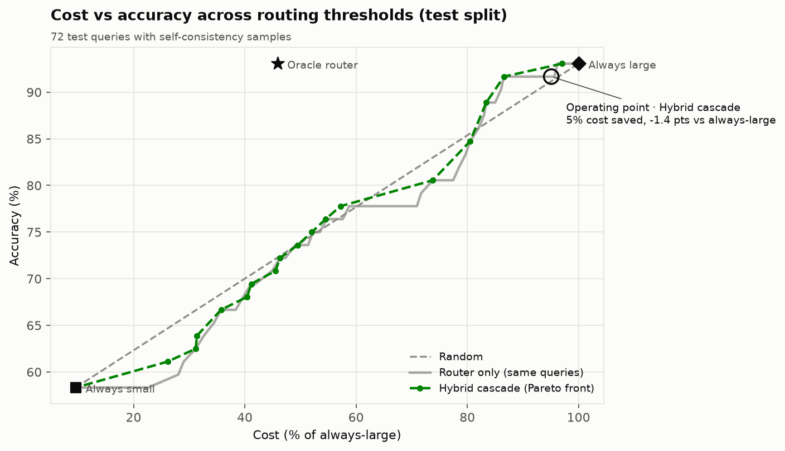
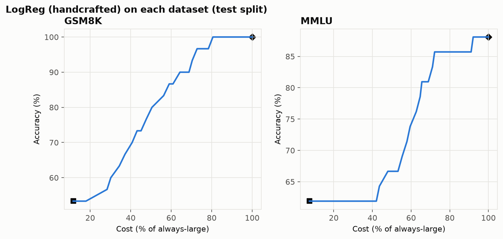
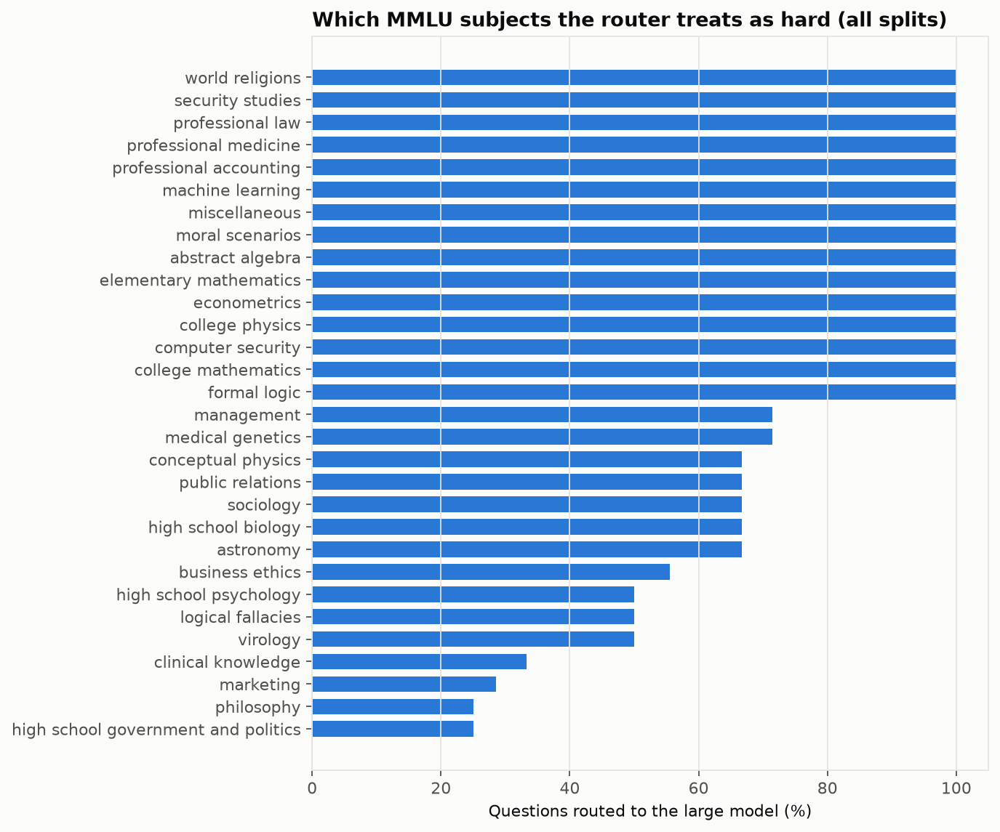
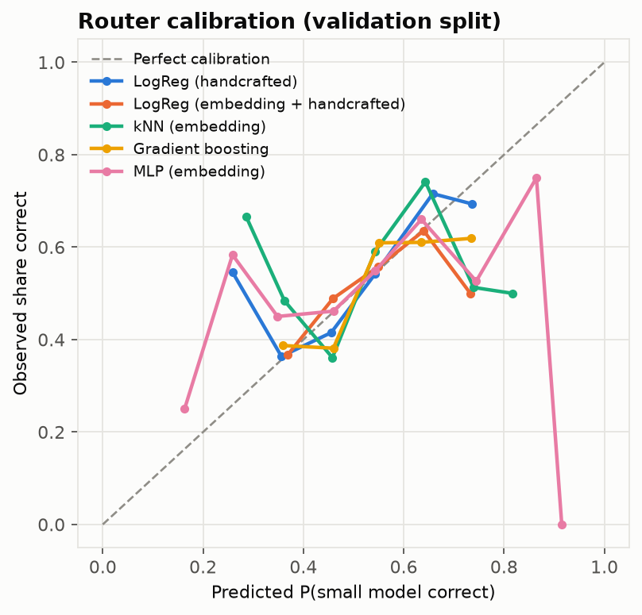
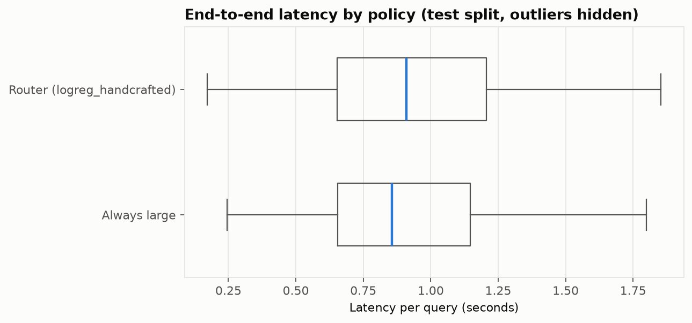

# Results

Generated 2026-10-26 from cached answers · profile `free_allam` · small `allam-2-7b` vs large `openai/gpt-oss-120b` · prices as of 2026-10-24.

Labelled queries: 404 train / 59 validation / 72 test (of 3029 in the full query set). Routers were compared and thresholds chosen on 5-fold out-of-fold predictions over train + validation; the final routers were refit on train + validation; the test split was scored once.

## Headline

**LogReg (handcrafted) saved 7.8% of LLM cost (95% CI [3.5%, 13.4%]) with a -1.4-point accuracy change vs always using the large model (95% CI [-4.2 pts, 0.0 pts]), adding 55 ms (p50) of routing latency.**

- Accuracy 91.7% vs 93.1% always-large and 58.3% always-small.
- 84.7% of queries went to the large model.
- Hard-query mis-route rate 4.0% (95% CI [0.0%, 13.0%]): share of queries only the large model solves that were sent to the small one.
- McNemar test vs always-large: p = 1.000 (0 queries only the router got right, 1 only always-large got right).
- Routing overhead (embedding + classifier, one CPU thread): p50 54.9 ms, p95 85.4 ms, measured while the machine's CPU was 20% busy with other work.
- Oracle router (upper bound): 54.1% saved at 93.1% accuracy.

## All routers (test split)

| Router | Accuracy at τ | Δ vs large | Cost saved | % to large | Hard mis-route | APGR (mean ± sd, 3 seeds) | CPT(50%) | CPT(80%) | CV ROC-AUC |
|---|---|---|---|---|---|---|---|---|---|
| Random | 90.3% | -2.8 | 4.9% | 95.8% | 8.0% | 0.478 | 59.0% | 87.0% | 0.438 |
| Length heuristic | 88.9% | -4.2 | 5.6% | 90.3% | 12.0% | 0.521 | 45.0% | 75.0% | 0.530 |
| LogReg (handcrafted) **(best)** | 91.7% | -1.4 | 7.8% | 84.7% | 4.0% | 0.584 ± 0.000 | 35.0% | 67.0% | 0.645 |
| LogReg (embedding + handcrafted) | 93.1% | +0.0 | 0.0% | 100.0% | 0.0% | 0.590 ± 0.000 | 38.0% | 63.0% | 0.578 |
| kNN (embedding) | 93.1% | +0.0 | 2.6% | 95.8% | 0.0% | 0.594 ± 0.025 | 30.0% | 64.0% | 0.617 |
| Gradient boosting | 93.1% | +0.0 | 13.2% | 79.2% | 0.0% | 0.605 ± 0.003 | 37.0% | 60.0% | 0.609 |
| MLP (embedding) | 93.1% | +0.0 | 0.0% | 100.0% | 0.0% | 0.601 ± 0.009 | 31.0% | 66.0% | 0.596 |
| Always small | 58.3% | -34.7 | 90.4% | 0% | 100% | 0 | | | |
| Always large | 93.1% | 0.0 | 0% | 100% | 0% | 1 | | | |
| Oracle | 93.1% | +0.0 | 54.1% | 34.7% | 0% | | | | |

APGR = area under the performance-gap-recovered curve (random = 0.5). CPT(x%) = share of calls to the large model needed to recover x% of the accuracy gap. The best router is the learned router with the highest out-of-fold APGR.

### The full trade-off (best router, test split)

Each row's threshold was chosen on out-of-fold predictions for that accuracy budget, then scored once on test.

| Allowed drop | τ | Accuracy | Δ vs large | Cost saved | % to large | Hard mis-route |
|---|---|---|---|---|---|---|
| 1 pts | 0.752 | 91.7% | -1.4 | 4.9% | 90.3% | 4.0% |
| 2 pts | 0.714 | 91.7% | -1.4 | 7.8% | 84.7% | 4.0% |
| 5 pts | 0.663 | 91.7% | -1.4 | 12.8% | 76.4% | 4.0% |
| 10 pts | 0.537 | 77.8% | -15.3 | 29.1% | 52.8% | 44.0% |

## Self-check cascade

Evaluated on the 72 test queries that have 2 extra small-model samples. Check = the main answer parses and at least 2 of 3 answers agree.

| Policy | Accuracy | Δ vs large | Cost saved | % answered by large | Hard mis-route | % checked | p95 latency |
|---|---|---|---|---|---|---|---|
| Router only | 91.7% | -1.4 | 7.8% | 84.7% | 4.0% | 0.0% | 2.4 s |
| Hybrid (τ_low 0.75, τ_high 0.75) | 91.7% | -1.4 | 4.9% | 90.3% | 4.0% | 0.0% | 2.0 s |
| Cascade only (always small first) | 69.4% | -23.6 | 46.6% | 13.9% | 68.0% | 100.0% | 2.7 s |
| Always large | 93.1% | +0.0 | 0.0% | 100.0% | 0.0% | 0.0% | 1.9 s |

Check quality: precision 90.0%, recall 30.0% for 'check failed' as a detector of 'small model was wrong'; it fails on 13.9% of queries.

## Robustness

- **Small-model price stand-in.** `allam-2-7b` has no published price. At the more conservative $0.075 / $0.3 per 1M tokens, the same frozen router saves 7.3% (oracle 46.5%).
- **GSM8K** (30 test queries): small 53.3%, large 100.0%; at τ accuracy 100.0%, 0.0% saved, 100.0% to large, APGR 0.635.
- **MMLU** (42 test queries): small 61.9%, large 88.1%; at τ accuracy 85.7%, 16.1% saved, 73.8% to large, APGR 0.545.
- **Generalisation GSM8K → MMLU**: trained on 193 GSM8K queries only, APGR 0.486 on 42 MMLU test queries (random = 0.5).
- **Generalisation MMLU → GSM8K**: trained on 211 MMLU queries only, APGR 0.584 on 30 GSM8K test queries (random = 0.5).

## Where the router fails

Hard queries (only the large model was right) that the router most confidently sent to the small model:

| Query | p(small ok) | Text |
|---|---|---|
| mmlu-test-3702 | 0.76 | The relative stability of American public policy is achieved largely through  A. cooperation between the two major political parties B. judicial activism C. the constitutional fragmentation of power D. affirmative action |

## API threshold presets (from out-of-fold predictions)

| Preset | τ |
|---|---|
| `router-quality` | 0.714 |
| `router-balanced` | 0.513 |
| `router-budget_30` | 0.456 |
| `router-budget_70` | 0.636 |
